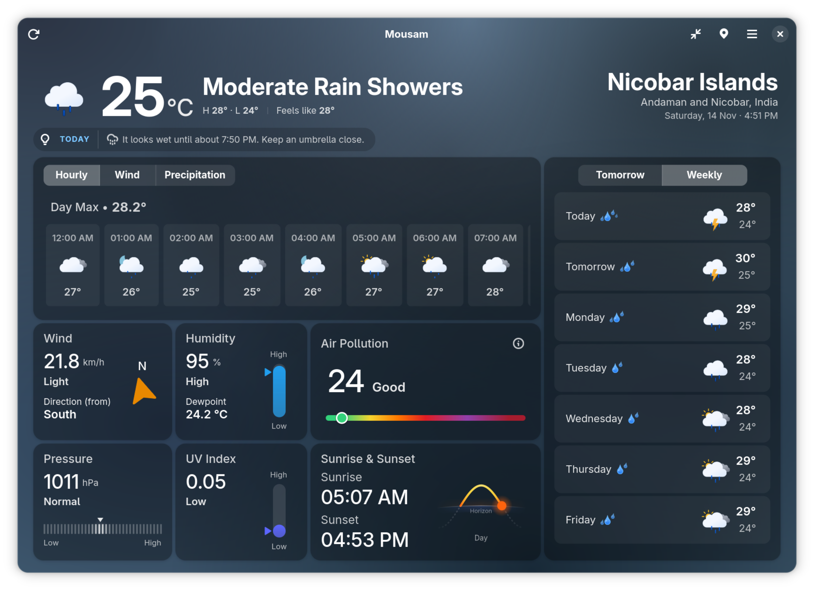
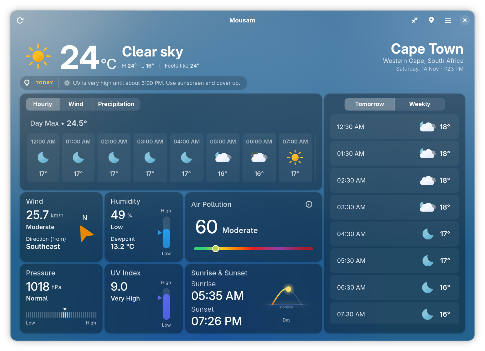
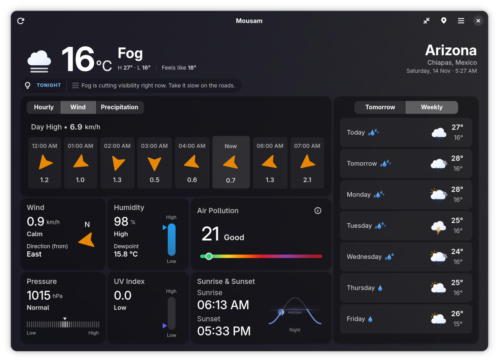
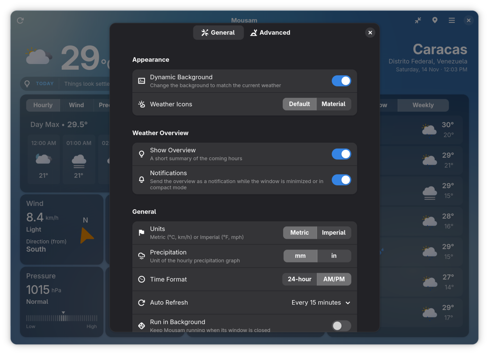
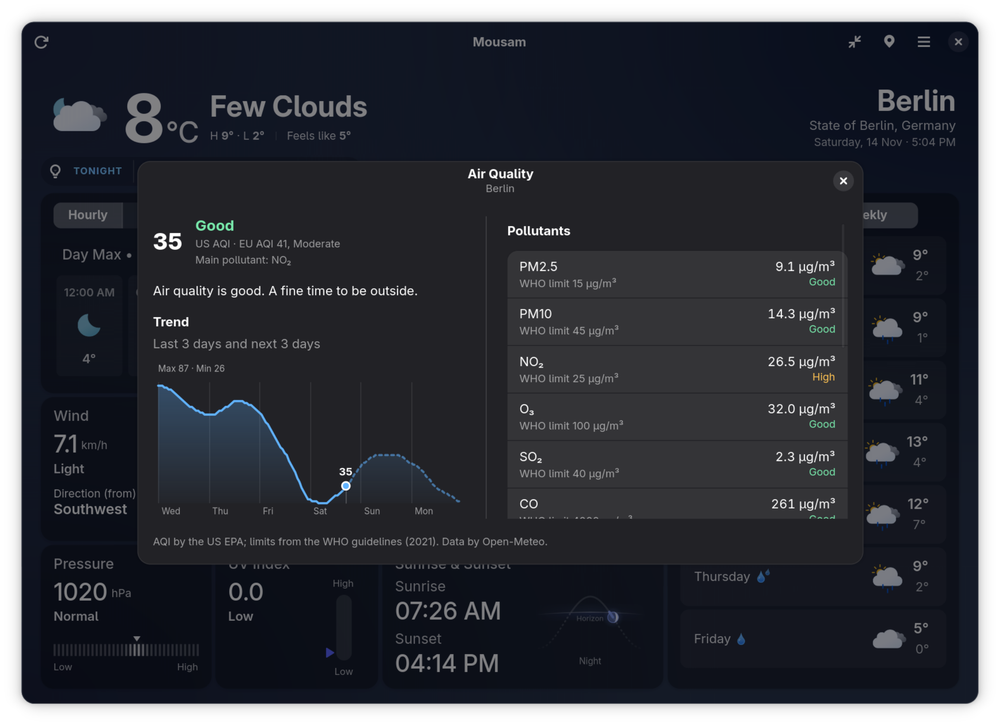
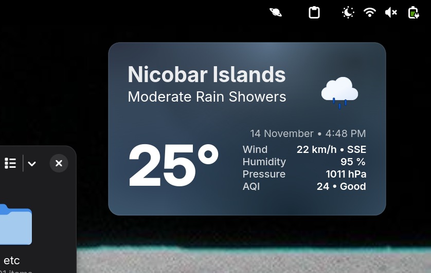

<div align="center">

<h1>Mousam</h1>

<p>Weather at a Glance</p>

<a href = "https://github.com/amit9838/mousam/releases"></a>
<a href = "https://github.com/amit9838/mousam/discussions"></a>
<a href = "https://amit9838.github.io/mousam/"></a>
<a href = "COPYING"></a>
<a href = "https://github.com/amit9838/mousam/actions/workflows/checks.yml"></a>

</div>
<div align="center">


</div>

## Features

- **Current conditions**: temperature, feels like, humidity, wind, pressure, UV index, dew point and visibility, each with a clear level
- **Weather Overview**: a one-line summary of the coming hours ("Rain likely around 5:00 PM (70% chance)."), also sent as a desktop notification while the window is minimized, in compact mode or closed
- **Detailed Forecasts**: hourly graphs for temperature, wind and precipitation, plus tomorrow and 7-day forecasts with temperature ranges and the chance of rain and snow
- **Air Quality**: US and EU AQI with pollutants, pollen and health advice, based on WHO guidelines
- **Sun and Moon**: the sun's path through the day, moon phase and twilight
- **Saved Locations**: switch between cities, see each one's weather and local time, and reorder them by drag and drop
- **Compact Mode**: a minimal window for focused weather tracking
- **Run in Background**: keep Mousam running when its window is closed, so overview notifications keep coming
- **Dynamic Backgrounds and Icons**: the interface follows the weather, with a choice of default or Material icons
- **Your Units**: metric or imperial, 12 or 24 hour clock
- **Translated**: available in 21 languages besides English

## Screenshots

<div align="center">




</div>

## Installation

### **Flatpak:**

<a href='https://flathub.org/apps/io.github.amit9838.mousam'></a>

- Or you can use the terminal:

```
flatpak install flathub io.github.amit9838.mousam
```

Update with `flatpak update io.github.amit9838.mousam`. Uninstall with `flatpak uninstall io.github.amit9838.mousam`, and add `--delete-data` to also remove its settings and logs.

### **Snap:**

<a href='https://snapcraft.io/mousam'></a>

- Or you can use the terminal:

```
sudo snap install mousam
```

Snap updates itself, or run `sudo snap refresh mousam`. Uninstall with `sudo snap remove mousam`.

## Build

### Dependencies

- GTK 4 and libadwaita 1.6 or newer, with their GObject introspection data
- Python 3 with PyGObject, pycairo and requests (`python3-gi`, `python3-gi-cairo`, `python3-requests` on Debian and Ubuntu)
- meson (0.61 or newer), gettext and the GLib tools (`glib-compile-resources`, `glib-compile-schemas`)
- `gtk-update-icon-cache` and `desktop-file-utils`, which the install step uses

### Build

```
rm -rf builddir
meson setup -Dprefix=$HOME/.local builddir
meson compile -C builddir --verbose
```

### Install

```
meson install -C builddir
```

### Run

```
mousam
```

## Troubleshooting

- **"No Internet" or "Fetch Error" page**: check your connection and press **Retry** (`Ctrl` + `R`). The weather comes from Open-Meteo, so Mousam needs network access.
- **No overview notifications**: they are sent only while the window is minimized, in compact mode or closed. To keep Mousam running after you close the window, turn on **Run in Background** in Preferences, and make sure notifications are allowed for Mousam in your system settings.
- **Start from scratch**: Preferences → Advanced → **Reset to Default** restores every setting and removes your saved locations.

### Reporting a bug with logs

1. Open Preferences → Advanced → **Logging and Debugging** and turn on **Debug Mode**.
2. Reproduce the problem, then use **Open Logs Folder** and attach the end of `mousam.log` to your [issue](https://github.com/amit9838/mousam/issues/new/choose).
3. Open the main menu → **About Mousam** → **Troubleshooting** and copy the information there. It lists the version, how Mousam was installed and your settings, but nothing about your saved places beyond how many there are.

The log file is in your cache folder:

| Installed from | Location of `mousam.log` |
| --- | --- |
| Source | `~/.cache/mousam/` |
| Flatpak | `~/.var/app/io.github.amit9838.mousam/cache/mousam/` |
| Snap | `~/snap/mousam/current/.cache/mousam/` |

## Privacy

Mousam has no account, no analytics and no server of its own.

- **Weather, air quality and city search** are requested from [Open-Meteo](https://open-meteo.com/). They are sent only the coordinates (or the search text) needed for the request.
- **Connection check**: to tell "you are offline" from "the weather service is down", Mousam first opens a connection to `1.1.1.1` (port 53) and, only if that fails, requests the home pages of a few well-known websites. No information about you is sent in these requests, but those hosts can see that your IP address made them.
- **Settings and saved places** stay on your computer, in GSettings.

## Contribution

Thanks to all the contributors have helped in the development project so that open-source community can enjoy best tools with best features.

<a href="https://github.com/amit9838/mousam/graphs/contributors">

</a>

See the [contribution guide](CONTRIBUTION_GUIDE.md) to report a bug, suggest a feature or send a change.

### Translations

Mousam is translated into 21 languages and every language lives in [po/](po/). Some translations are machine generated: such files start with a note saying so. Reviews and corrections are very welcome, and a reviewer removes that note once the file has been checked. The [guide](CONTRIBUTION_GUIDE.md#translation-contributions-) explains how to add or improve a language.

## Credits

- Thanks to [Open Meteo](https://open-meteo.com/) from providing weather data for free of cost.

- Thanks to [@basmilius](https://github.com/basmilius) for the beautiful [Meteocons](https://github.com/basmilius/meteocons) weather icons.

- The Material weather icons are from Google, collected by [Darren Griffin](https://github.com/mrdarrengriffin/google-weather-icons).

## License

Mousam is free software, released under the [GNU General Public License v3.0 or later](COPYING).

<div align="center">
 <h2>Support</h2>
I hope you ❤️ <b>Mousam</b>, if you think it is worth supporting you can do so using below methods
<br>
<br>
 
<div>
<a href="https://www.paypal.com/ncp/payment/MDNGWG9HQZDCE">
     
</a>
<span>&nbsp; &nbsp; &nbsp;</span>
<a href="https://www.buymeacoffee.com/ami9838">
    
</a>
</div>
<div align="center">
</div>
